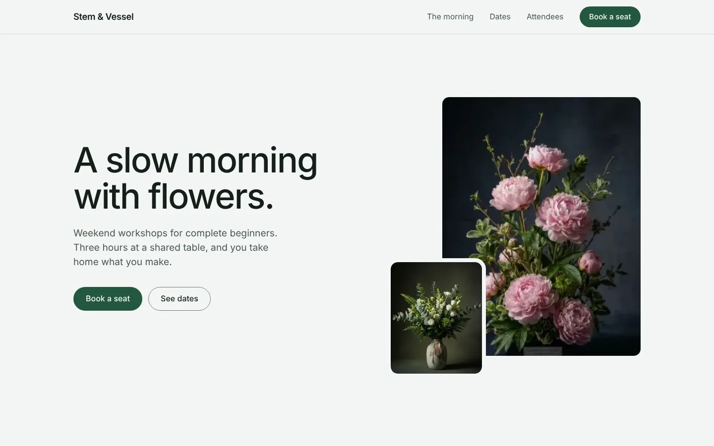
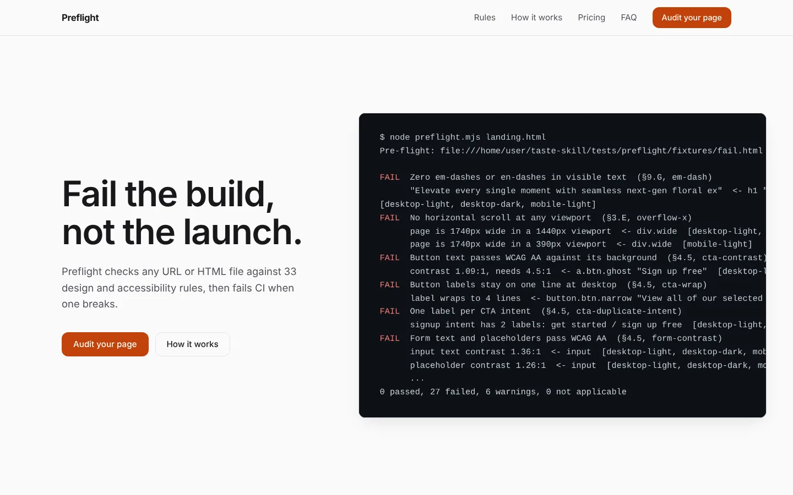
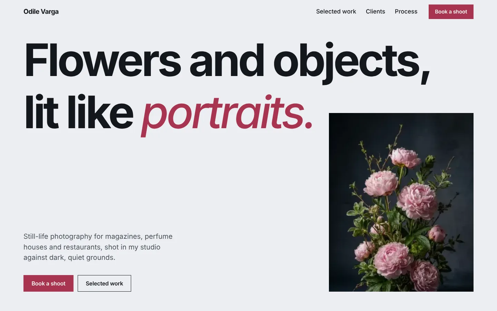
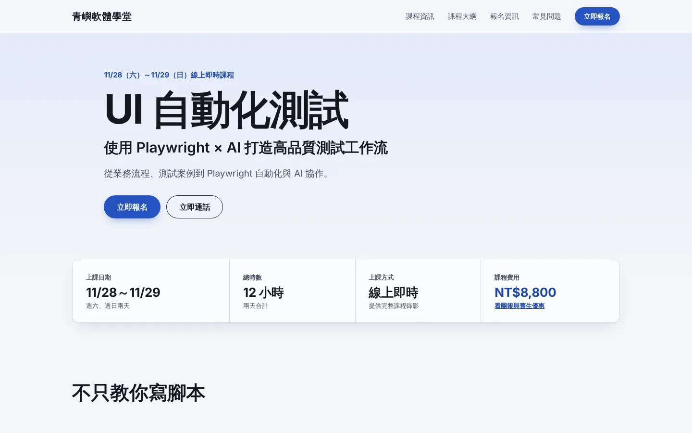
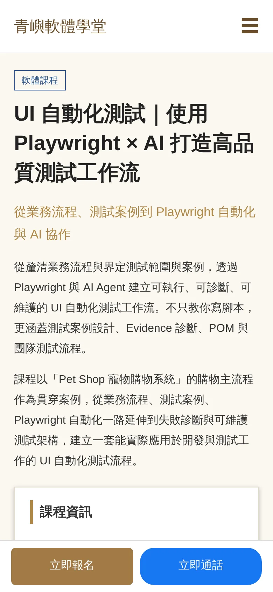

<p align="center">
  
</p>

# Taste Skill

<p align="center"><a href="README.md">English</a> | <b>繁體中文</b></p>

<p align="center">
  <em>給 AI Agent 用的反罐頭前端框架</em>
</p>

<p align="center" style="margin-bottom: 8px;">
  <a href="https://tasteskill.dev" title="前往 tasteskill.dev"></a>
</p>

<h3 align="center">贊助商</h3>

<p align="center">
  <a href="https://novamira.ai/" title="Novamira"></a>
  &nbsp;
  <strong><a href="https://novamira.ai/">Novamira</a></strong> · 讓 AI agent 完整操作 WordPress
  &nbsp;&nbsp;&nbsp;&nbsp;
  <picture>
    <source media="(prefers-color-scheme: dark)" srcset="https://kimi-file.moonshot.cn/prod-chat-kimi/kfs/4/1/2026-06-05/1d8h69mt3v89kkekg24gg" />
    
  </picture>
</p>

<table align="center">
  <tr>
    <td align="center" width="76"><a href="https://img.ly/"></a></td>
    <td><sub><a href="https://img.ly/"><strong>IMG.LY</strong></a> · CreativeEditor SDK</sub></td>
  </tr>
  <tr>
    <td align="center" width="76"><a href="https://animations.dev"></a></td>
    <td><sub><a href="https://github.com/emilkowalski"><strong>Emil Kowalski</strong></a> · <a href="https://animations.dev">animations.dev</a></sub></td>
  </tr>
  <tr>
    <td align="center" width="76"><a href="https://www.sent.dm"></a></td>
    <td><sub><a href="https://www.sent.dm"><strong>Sent.dm</strong></a> · SMS、WhatsApp 與 RCS 簡訊 API</sub></td>
  </tr>
  <tr>
    <td align="center" width="76"><a href="https://vercel.com/open-source-program"></a></td>
    <td><a href="https://vercel.com/open-source-program"></a></td>
  </tr>
</table>

<p align="center"><sub><a href="https://github.com/sponsors/Leonxlnx">成為贊助商</a></sub></p>

一組可攜式的 **Agent Skills**，讓 AI 做出來的介面在版面、字體、動態和間距上更講究，而不是一看就像套版。這個 repo 也收錄了 **圖像生成 skills**，用來產出參考圖（網頁、手機介面、品牌識別）。可以搭配 **ChatGPT Images** 等生成工具使用，再把圖交給 Codex、Cursor 或 Claude Code 實作。

<p align="center">
  <a href="LICENSE"></a>
  &nbsp;
  <a href="https://github.com/vercel-labs/agent-skills"></a>
  &nbsp;
  <a href="#安裝"></a>
  &nbsp;
  <a href="https://www.tasteskill.dev/changelog"></a>
</p>

## 免責聲明

Taste Skill 沒有任何官方代幣、虛擬貨幣或加密貨幣專案。任何使用我的名字、肖像或本專案名義的代幣，都與我無關，也未經我背書。

<p align="center"><sub><a href="#免責聲明">免責聲明</a> | <a href="#安裝">安裝</a> | <a href="#skills-一覽">Skills</a> | <a href="#設定">設定</a> | <a href="#範例">範例</a> | <a href="#支持這個專案">贊助</a> | <a href="#研究">研究</a> | <a href="#常見問題">常見問題</a> | <a href="#授權">授權</a></sub></p>

## 意見回饋與貢獻

非常歡迎你的回饋。建議和錯誤回報可以透過：

- 在 GitHub 開 Pull Request 或 Issue
- 私訊 [@lexnlin](https://x.com/lexnlin) 或 [@blueemi99](https://x.com/blueemi99)
- 寄信到 [hello@tasteskill.dev](mailto:hello@tasteskill.dev)

## 安裝

[`npx skills add`](https://github.com/vercel-labs/agent-skills) CLI 會掃描這個 repo 的 `skills/` 資料夾，所以 **下面所有 skills（程式碼類和圖像生成類）的安裝方式都一樣。**

```bash
npx skills add https://github.com/Leonxlnx/taste-skill
```

只安裝單一 skill 時，請用它的 **安裝名稱**（SKILL 檔頭的 `name:` 欄位，不是資料夾名稱）：

```bash
npx skills add https://github.com/Leonxlnx/taste-skill --skill "design-taste-frontend"
```

你也可以直接把任何一份 `SKILL.md` 複製到專案裡，或貼進 ChatGPT / Codex 的對話中。

### 從舊版升級

預設的 `taste-skill`（安裝名稱 `design-taste-frontend`）現在是 **v2（實驗版）**，是對原本 v1 的大幅改寫。如果你已經裝了 v1，重新執行安裝指令就會升級：

```bash
npx skills add https://github.com/Leonxlnx/taste-skill --skill "design-taste-frontend"
```

安裝名稱沒有變，所以不需要改任何腳本，新的 SKILL.md 會直接取代舊的。

如果你依賴 v1 的特定行為，想明確固定在 v1：

```bash
npx skills add https://github.com/Leonxlnx/taste-skill --skill "design-taste-frontend-v1"
```

完整的 v1 到 v2 差異和改版理由，請見 [CHANGELOG.md](CHANGELOG.md)（英文）。

## Skills 一覽

每個 skill 只做一件事，不需要全部一起用。**實作類 skills** 產出程式碼，**圖像生成類 skills** 只產出參考圖。

「安裝名稱」欄就是傳給 `--skill` 的值。

| Skill（資料夾） | 安裝名稱 | 說明 |
| --- | --- | --- |
| **taste-skill** | `design-taste-frontend` | 🆕 **v2（實驗版）**，預設 skill 的大幅改寫。先讀懂需求、推斷設計語言，再調整三個旋鈕（VARIANCE / MOTION / DENSITY）。包含需求推斷、設計系統對照、破折號硬性禁令、GSAP 標準程式骨架、改版前診斷流程，以及嚴格的上線前檢查。正朝 v2.0.0 穩定版持續迭代。 |
| **taste-skill-v1** | `design-taste-frontend-v1` | taste-skill 原始的 v1，保留給依賴其特定行為的專案。只有在 v2 預設版搞壞你工作流程中某個環節時才用。 |
| **gpt-tasteskill** | `gpt-taste` | 給 GPT/Codex 用的嚴格版：版面變化更大、GSAP 方向更強、反罐頭更積極。 |
| **image-to-code-skill** | `image-to-code` | 先出圖的流程：生成網站參考圖、分析，再實作出相符的前端。 |
| **redesign-skill** | `redesign-existing-projects` | 用於既有專案：先診斷 UI，再修正版面、間距、層次和樣式。 |
| **soft-skill** | `high-end-visual-design` | 精緻、沉穩、有高級感的 UI：較柔和的對比、留白、質感字體、彈簧動態。 |
| **output-skill** | `full-output-enforcement` | 當模型交出半成品時使用：要求完整輸出，不留佔位註解。 |
| **minimalist-skill** | `minimalist-ui` | 編輯感的產品 UI（Notion/Linear 風格），克制的配色、俐落的結構。 |
| **brutalist-skill** | `industrial-brutalist-ui` | 硬派機械語言：瑞士風字體、強烈對比、實驗性版面。 |
| **stitch-skill** | `stitch-design-taste` | 相容 Google Stitch 的規則，包含可選的 `DESIGN.md` 匯出格式。 |

### 圖像生成 skills

這些只產出設計圖（沒有程式碼）。可搭配 ChatGPT Images、Codex 圖像模式，或任何能生成圖片的 agent。

| Skill（資料夾） | 安裝名稱 | 說明 |
| --- | --- | --- |
| **imagegen-frontend-web** | `imagegen-frontend-web` | 網站設計稿：主視覺、landing page、多區塊頁面，字體與間距講究，美術方向反罐頭。 |
| **imagegen-frontend-mobile** | `imagegen-frontend-mobile` | 手機畫面與流程：iOS / Android / 跨平台、mockup、易讀字體、風格一致的整組畫面。 |
| **brandkit** | `brandkit` | 品牌識別板：logo 方向、配色、字體，以及跨類別的識別應用。 |

### 該用哪一個？

- 從 **taste-skill** 開始，它是最穩妥的通用預設。（現在是 v2 實驗版，改了什麼請見 [CHANGELOG](CHANGELOG.md)。）
- 如果你依賴原始 taste-skill 的特定行為，改裝 **taste-skill-v1**。
- 想要更嚴格、針對 GPT/Codex 的規則和動態、版面要求時，用 **gpt-taste**。
- 「出圖、分析、寫程式」的網站流程，用 **image-to-code-skill**。
- 要改善既有程式碼而不是從零設計，用 **redesign-skill**。
- 視覺方向已經決定時，加上 **soft-skill**、**minimalist-skill** 或 **brutalist-skill**。
- 如果 agent 老是截斷輸出，加上 **output-skill**。
- 交付物是 **圖片**（設計稿、流程圖、識別板）時，用 **imagegen-frontend-web**、**imagegen-frontend-mobile** 或 **brandkit**，再把結果交給你的 coding agent。

### 先出圖的小技巧

使用 **image-to-code-skill** 時，在 prompt 裡寫明流程，例如：`follow the skill: generate images, then analyze, then code`。

### ChatGPT Images 與 Codex

附上或貼上 **`imagegen-frontend-web`**、**`imagegen-frontend-mobile`** 或 **`brandkit`**，要求你需要的畫面，再把生成的圖交給 Codex、Cursor 或 Claude Code。如果想用一個流程同時生成參考圖並寫成程式，用 **image-to-code-skill**。

## 設定

只適用於 taste-skill。檔案開頭的數字是 1 到 10 的旋鈕：

- **DESIGN_VARIANCE**：版面實驗程度（低：置中、乾淨；高：不對稱、現代）。
- **MOTION_INTENSITY**：動畫深度（低：hover 效果；高：捲動、磁吸效果）。
- **VISUAL_DENSITY**：每個畫面的資訊量（低：寬鬆；高：密集的儀表板）。

## 範例

用 taste-skill 做出來的頁面：

<p>
  
  
</p>

### 盲測作品

以下四頁由一個代理生成，它只讀了 `skills/taste-skill/SKILL.md` 和一份需求，生成後再用 [`tests/preflight/`](tests/preflight/) 檢查。四頁全部通過 34 條可量測的規則。需求、注意事項和原始碼請見 [`examples/blind-trials/`](examples/blind-trials/README.zh-TW.md)。

<table>
  <tr>
    <td width="50%"><a href="examples/blind-trials/workshop/"></a><br /><sub><b>工作坊報名頁</b>：沉穩、現代、帶點質感</sub></td>
    <td width="50%"><a href="examples/blind-trials/saas/"></a><br /><sub><b>SaaS 首頁</b>：給前端工程師的開發者工具</sub></td>
  </tr>
  <tr>
    <td width="50%"><a href="examples/blind-trials/portfolio/"></a><br /><sub><b>作品集</b>：大膽、有編輯感、Awwwards 水準的需求</sub></td>
    <td width="50%"><a href="examples/blind-trials/course-redesign/"></a><br /><sub><b>改版</b>：繁體中文課程頁</sub></td>
  </tr>
</table>

課程頁在手機上的改版前後。原頁把價格和日期藏在一大段文字下面，對比度和首屏兩項檢查都沒通過：

<p>
  
  &nbsp;
  
</p>

### 自己檢查一個頁面

[`tests/preflight/`](tests/preflight/) 會用 Chromium 開啟任何網址或 HTML 檔，在桌面淺色、桌面深色、手機和減少動態四種情境下，檢查上線前檢查清單中可量測的部分。只要有硬性規則失敗，就會以非零狀態結束，所以可以接進 CI 當關卡。

```bash
cd tests/preflight && npm install && npx playwright install chromium
node preflight.mjs path/to/page.html
```

## 支持這個專案

如果 Taste Skill 對你有幫助，歡迎贊助：

[在 GitHub 上贊助](https://github.com/sponsors/Leonxlnx)

### 社群贊助者

<a href="https://github.com/dnakov"></a>
<a href="https://github.com/AkramReshad"></a>
<a href="https://github.com/ajmalaksar25"></a>
<a href="https://github.com/krikkkk"></a>
<a href="https://github.com/navanchauhan"></a>
<a href="https://github.com/robinebers"></a>
<a href="https://github.com/JKc66"></a>
<a href="https://github.com/u2393696078-rgb"></a>
<a href="https://github.com/a-human-created-this"></a>
<a href="https://github.com/AtharvaJaiswal005"></a>
<a href="https://github.com/ghughes7"></a>
<a href="https://github.com/mccun934"></a>
<a href="https://github.com/techmedic5"></a>
<a href="https://github.com/bytewerk-dev"></a>
<a href="https://github.com/LuisGot"></a>
<a href="https://github.com/oskar-collab"></a>

<p align="center">
 <a href="https://www.star-history.com/leonxlnx/taste-skill">
  <picture>
   <source media="(prefers-color-scheme: dark)" srcset="https://api.star-history.com/badge?repo=Leonxlnx/taste-skill&theme=dark" />
   <source media="(prefers-color-scheme: light)" srcset="https://api.star-history.com/badge?repo=Leonxlnx/taste-skill" />
   
  </picture>
 </a>
</p>

## 研究

影響這些 skills 的背景研究放在 [`research/`](research/)（英文）。

## 常見問題

**這和其他 AI 設計 skills 有什麼不同？**
有多個專門化的版本，主要 skills 有可調整的旋鈕，反重複的規則來自專門的研究。所有 skills 都不綁定框架，可用於各大 coding agent。

**可以用在 React、Vue、Svelte 嗎？**
可以。規則針對的是設計意圖，不是特定框架的 API。

**什麼是 SKILL.md？**
一份可攜式的指令檔，agent 可以自動載入。可以用 `npx skills add` 安裝，或直接複製到 repo 或對話裡。

**圖像生成 skills 也能用 `npx skills add` 安裝嗎？**
可以。它們和程式碼類 skills 一起放在 `skills/` 底下，所以同一個 CLI 都找得到。

## 授權

[MIT 授權](LICENSE) | Copyright (c) 2026 Leonxlnx
